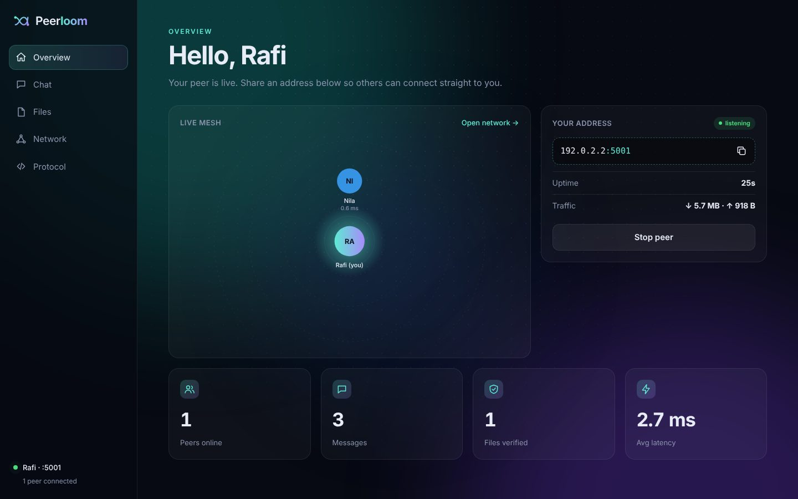
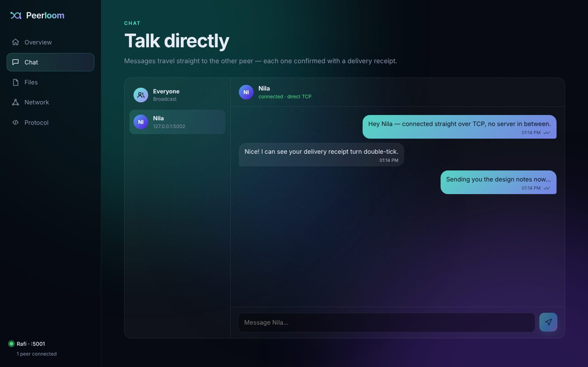
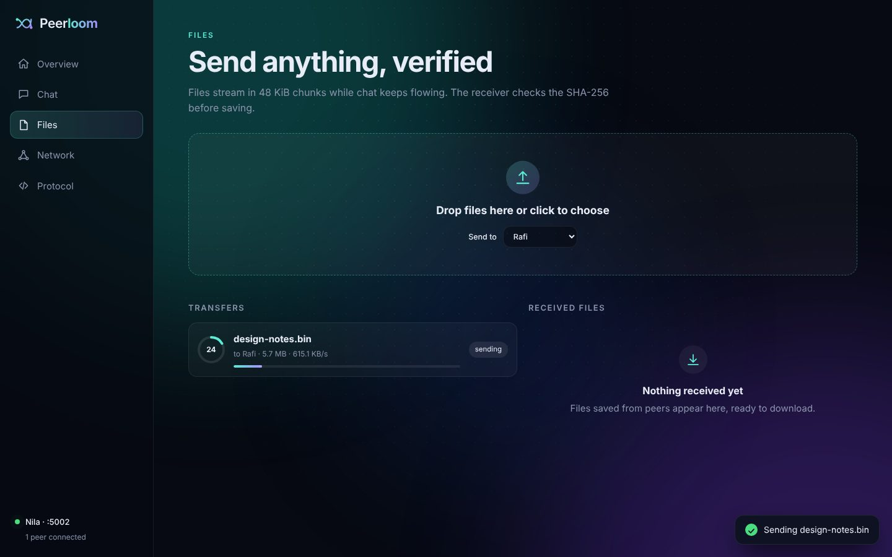
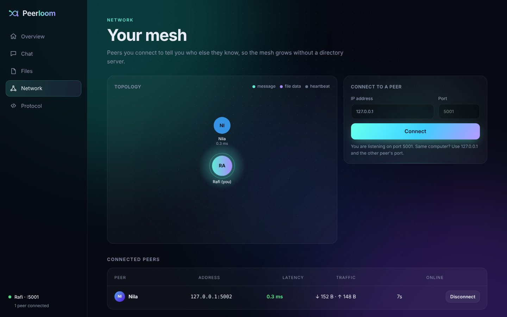
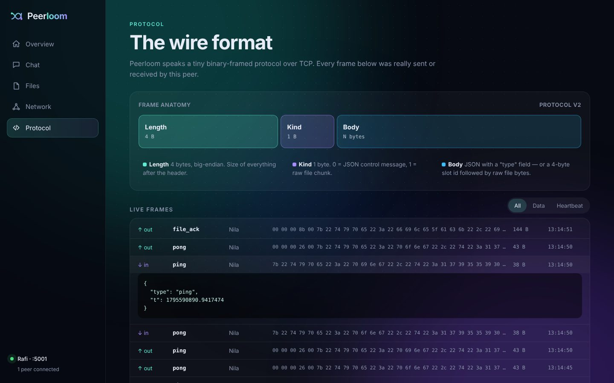

<p align="center"></p>

<p align="center">
  <b>Serverless peer-to-peer chat and checksum-verified file sharing over plain TCP,<br>with a real-time animated dashboard.</b>
</p>

<p align="center">
  
  
  
  
  
</p>

<p align="center"></p>

## What is Peerloom?

Peerloom lets computers talk to each other **directly** — no central server, no accounts, no cloud. Every running copy is a *peer*: it listens on a TCP port **and** dials other peers at the same time. Peers can chat, broadcast, and send files of any size; each file is verified with SHA-256 before it is saved.

The Python node does all networking with the standard library only (sockets, threads). A Next.js dashboard shows what the node is doing live — the mesh, every message, every transfer, and every byte-level frame on the wire.

| | |
|---|---|
| **Chat** | Direct and broadcast messages with delivery receipts (single tick → double tick) |
| **Files** | Chunked streaming, live progress and speed, SHA-256 verification, `.part` safety, name sanitising |
| **Mesh** | Peer exchange: connect to one peer and learn about the others it knows |
| **Heartbeat** | Round-trip latency per peer; silent peers are dropped after 20 s |
| **Inspector** | Every frame sent or received is captured and shown as hex plus decoded JSON |

## Screenshots

<table>
<tr>
<td></td>
<td></td>
</tr>
<tr>
<td></td>
<td></td>
</tr>
<tr>
<td colspan="2"></td>
</tr>
</table>

## Run it

You need **Python 3.9+** and **Node.js 18+**. The Python side installs nothing.

**Windows (PowerShell in the project folder)**

```powershell
.\run.bat
```

If PowerShell blocks scripts: `Set-ExecutionPolicy -Scope Process -ExecutionPolicy RemoteSigned`

**macOS / Linux / Git Bash**

```bash
./run.sh
```

Then open <http://localhost:3000>, type a name and a port, and press **Start my peer**.

### Try it alone (two peers on one computer)

```powershell
.\run-demo.bat        # Windows
./run-demo.sh         # macOS / Linux
```

This starts two independent nodes. Open both tabs it prints, start peer A on port `5001` and peer B on `5002`, then in A go to **Network** and connect to `127.0.0.1` port `5002`.

### Two real computers

Both on the same Wi-Fi: run `run.bat` on each, start a peer, and on one of them connect to the other's IP shown on the **Overview** page (allow Python through the firewall when asked).

## Architecture

```
 Browser (Next.js, Framer Motion)
        │  HTTP + Server-Sent Events  (127.0.0.1 only)
        ▼
 ┌──────────────────────────────┐        TCP        ┌──────────────────────────────┐
 │  Peerloom node               │ ◄───────────────► │  Peerloom node               │
 │  accept · reader-per-peer    │   framed protocol │  accept · reader-per-peer    │
 │  heartbeat · uploaders       │                   │  heartbeat · uploaders       │
 └──────────────────────────────┘                   └──────────────────────────────┘
```

- **Threads:** one accept loop, one reader per connection, one heartbeat loop, one uploader per outgoing file — so a slow transfer never blocks chat.
- **Dashboard API** is bound to `127.0.0.1` and checks the `Origin` header, so other websites cannot drive your node. The P2P port is the only thing exposed to the network.

### Wire protocol (v2)

Every frame is `[ 4-byte length ][ 1-byte kind ][ body ]`, big-endian.

| Kind | Body | Used for |
|---|---|---|
| `0` JSON | UTF-8 object with a `type` field (≤ 1 MiB) | `hello`, `hello_ack`, `text`, `ack`, `ping`, `pong`, `peers`, `file_start`, `file_ack`, `error`, `bye` |
| `1` chunk | 4-byte slot id + raw bytes (≤ 48 KiB) | file data |

Because file data travels as small chunk frames tagged with a slot id, chat messages and heartbeats interleave between chunks, and several files can move over one connection at once. A transfer ends when the receiver replies with `file_ack` — `ok: true` only if the SHA-256 matches.

Handshake rules: protocol versions must match, a peer cannot connect to itself, and a second connection to the same peer id is refused.

## HTTP API (used by the dashboard)

| Method | Path | Purpose |
|---|---|---|
| GET | `/api/events` | Server-Sent Events: snapshot, peers, messages, transfers, frames, stats |
| GET | `/api/state` | Full current state |
| POST | `/api/start` · `/api/stop` | Start / stop this peer |
| POST | `/api/connect` · `/api/disconnect` | Manage connections |
| POST | `/api/messages` | Send text (`to` = peer id or `all`) |
| POST | `/api/files?to=…&name=…` | Upload a file to send (raw body) |
| GET | `/api/files/<name>` | Download a received file |

## Tests

```bash
cd backend
python -m unittest discover -s tests
```

Covers the handshake, self/duplicate rejection, delivery receipts, checksum-verified transfer, path-traversal protection, peer exchange, and disconnect detection — using real sockets between in-process nodes.

## Project layout

```
backend/peerloom/   protocol.py · node.py · api.py · events.py · util.py · __main__.py
backend/tests/      end-to-end node tests
frontend/           Next.js app: app/ (pages) · components/ · lib/ (store, formatting)
docs/               banner, screenshots, demo
run.bat / run.sh    one-command launchers (+ run-demo.* for a two-peer sandbox)
```

## Known limits

- No encryption: traffic is plain TCP. Use it on networks you trust, or tunnel it (VPN / SSH).
- No NAT traversal: peers must be reachable (same LAN, VPN, or a forwarded port).
- Peer discovery is exchange-only; there is no bootstrap directory.
- Message history lives in memory and resets when a peer stops.

## License

MIT — see [LICENSE](LICENSE).
